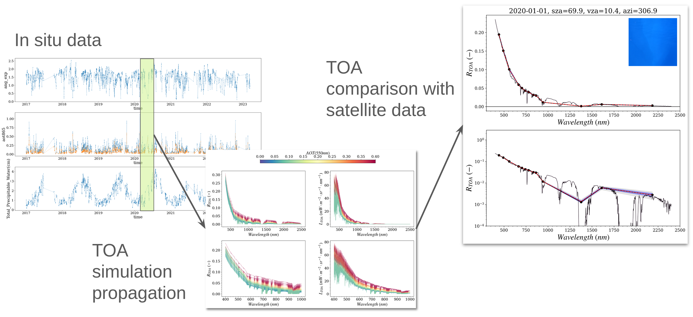

# RADCALNET-OC package
## Tools for Cal/Val operation of passive optical satellite over ocean and coastal waters

Principle 
-------

<picture>
  <source media="(prefers-color-scheme: dark)" srcset="docs/source/_static/slide_boa2toa_dark.png">
  
</picture>

# Usage

## Installation

Python >= 3.9 is required (3.11 or 3.12 recommended), e.g. in a conda environment:

    conda create python=3.12 -n radcalnet_oc
    conda activate radcalnet_oc

Install the package from PyPI, or from a clone of this repository:

    pip install radcalnet_oc
    pip install .                # from the repository

### Look-up table (LUT)

The radiative transfer TOA look-up table of the atmosphere (`toa_lut_opac_wind_v3.nc`, about 900 MB)
is not part of the package: it is downloaded from [Zenodo](https://doi.org/10.5281/zenodo.23394202)
(checksum verified) the first time the LUTs are loaded, into `~/.local/share/radcalnet_oc/lut` by
default. It is the LUT of [GRS](https://github.com/CNES/GRSprocessor): if you already have it, point
radcalnet_oc to its folder instead.

    radcalnet_oc_config                         # configuration in use and LUT check
    radcalnet_oc_config --download              # download the LUT now
    radcalnet_oc_config --init /path/to/lut     # use an existing LUT folder (e.g. the GRS one)

The LUT folder can also be set with the environment variable `RADCALNET_OC_DATA_ROOT`; the automatic
download is switched off with `RADCALNET_OC_NO_DOWNLOAD=1`. Without the LUT, a light version shipped
with the package is used, with a lower accuracy.

Version history: [CHANGELOG.md](CHANGELOG.md).

### Tests

    pip install ".[dev]"
    pytest

