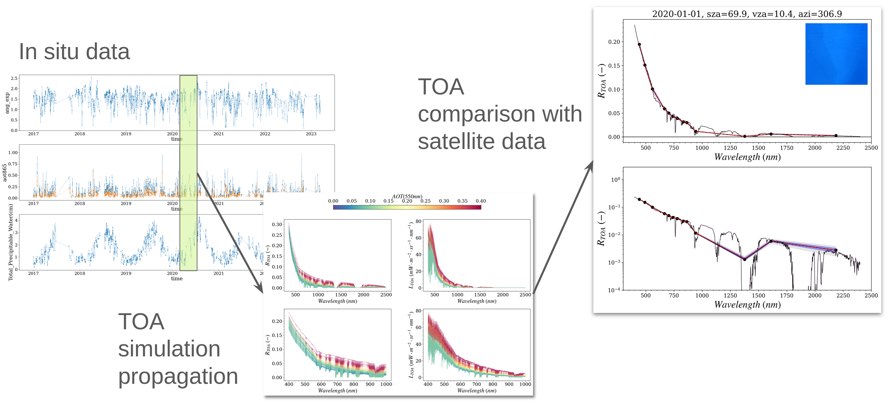

radcalnet-oc documentation
==========================

``radcalnet_oc`` models the radiative transfer through the atmosphere to propagate the water-leaving
radiance measured at the surface, typically by AERONET-OC stations, up to the top-of-atmosphere level.
The simulated top-of-atmosphere reflectance is used for the calibration and validation (Cal/Val) of
passive optical satellite sensors above coastal and oceanic waters.

.. math::

   R_{toa}(\lambda) = \pi\, R_{rs}(\lambda)\, T^{\downarrow}(\lambda)\, t^{\uparrow}(\lambda)\, T_g^{w}(\lambda)
   + T_g^{atm}(\lambda)\, R_{atm}(\lambda),
   \qquad
   T_g^{X} = \left(1 + s_X^2\, \eta_X\, \tau_g\right)^{-1/s_X^2}

The gaseous absorption is coupled with the scattering: the path reflectance :math:`R_{atm}` and the
water-leaving term have their own gaseous transmittances, :math:`T_g^{atm}` and :math:`T_g^{w}`, from a
photon path-length model (:math:`\tau_g` optical thickness of the absorbers along the geometric path,
:math:`\eta_X` and :math:`s_X^2` mean and relative variance of the absorber paths of each term) fitted on
full radiative transfer simulations of the coupled absorption and scattering (see :doc:`methods`).

.. only:: html

   .. figure:: _static/slide_boa2toa_dark.png
      :figclass: only-dark
      :alt: Propagation of the water-leaving signal from bottom to top of atmosphere

.. toctree::
   :maxdepth: 2
   :caption: User guide

   installation
   usage
   methods
   processing_chain

.. toctree::
   :maxdepth: 2
   :caption: Tutorials

   tutorials/radcalnet_oc_aeronet_oc_quickstart
   tutorials/radcalnet_oc_products
   tutorials/radcalnet_oc_toa_simulation
   tutorials/radcalnet_oc_aeronet_oc_toa
   tutorials/radcalnet_oc_gaseous_transmittance
   tutorials/radcalnet_oc_solar_irradiance
   tutorials/radcalnet_oc_downwelling_irradiance
   tutorials/sentinel3_radcalnet_oc_matchup
   tutorials/research/index

.. toctree::
   :maxdepth: 2
   :caption: Reference

   api
   history

Indices and tables
------------------

* :ref:`genindex`
* :ref:`modindex`
* :ref:`search`
