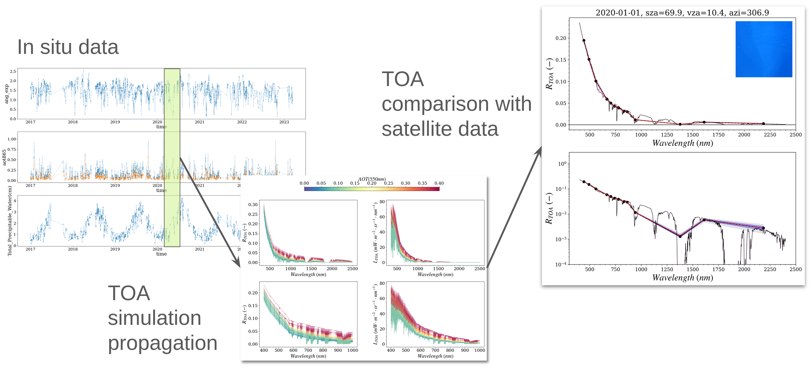

.. _methods:

Methods
=======

This page describes what :py:meth:`Process.execute <radcalnet_oc.process.Process.execute>` computes
to propagate the water-leaving signal measured at bottom-of-atmosphere (BOA) by AERONET-OC stations
up to the top-of-atmosphere (TOA) level, and the equations of the other modules of the package
(aerosol model retrieval, sunglint, spectral response of the sensors).

   Principle of the BOA-to-TOA propagation.

.. only:: html

   .. figure:: _static/slide_boa2toa_dark.png
      :width: 100%
      :figclass: only-dark
      :alt: Propagation of the water-leaving signal from bottom to top of atmosphere

      Principle of the BOA-to-TOA propagation.

Notation
--------

.. list-table::
   :header-rows: 1
   :widths: 20 60 20

   * - Symbol
     - Definition
     - Unit
   * - :math:`\lambda`
     - wavelength
     - nm
   * - :math:`\theta_0,\ \theta_v,\ \phi`
     - solar zenith, viewing zenith and relative azimuth angles; following the radiative transfer
       convention of the look-up tables, :math:`\phi = 0` when the viewing direction points towards the
       Sun (specular reflection, sunglint geometry) and :math:`\phi = 180°` for the backscattering
       geometry (Sun behind the sensor)
     - deg
   * - :math:`\mu_0 = \cos\theta_0,\ \mu_v = \cos\theta_v`
     - cosines of the solar and viewing zenith angles
     - --
   * - :math:`F_0(\lambda)`
     - extraterrestrial solar irradiance at mean Earth-Sun distance
     - mW m\ :sup:`-2` nm\ :sup:`-1`
   * - :math:`E_0(\lambda)`
     - plane solar irradiance at TOA
     - mW m\ :sup:`-2` nm\ :sup:`-1`
   * - :math:`E_d(\lambda)`
     - downwelling plane irradiance at BOA
     - mW m\ :sup:`-2` nm\ :sup:`-1`
   * - :math:`R_{rs}(\lambda)`
     - remote sensing reflectance
     - sr\ :sup:`-1`
   * - :math:`L_w(\lambda)`
     - water-leaving radiance
     - mW m\ :sup:`-2` sr\ :sup:`-1` nm\ :sup:`-1`
   * - :math:`\tau_a,\ \tau_r`
     - aerosol and Rayleigh optical thickness
     - --
   * - :math:`T_g^{\downarrow},\ T_g^{\uparrow}`
     - downward and upward gaseous transmittances of the direct beam (air masses :math:`1/\mu_0`,
       :math:`1/\mu_v`)
     - --
   * - :math:`T_g^{atm},\ T_g^{w},\ T_g^{E_d}`
     - gaseous transmittances of the path reflectance, of the water-leaving term and of the downwelling
       irradiance, coupled with the scattering (Eq. :eq:`tg_term`)
     - --
   * - :math:`T^{\downarrow},\ t^{\uparrow}`
     - downward (irradiance) and upward (radiance) atmospheric transmittances
     - --

Processing steps
----------------

For each measurement of the input time series (see :doc:`usage`),
:py:class:`~radcalnet_oc.process.Process` computes, at the full spectral resolution of the
gaseous absorption look-up table:

1. **Solar irradiance at TOA** :math:`E_0`, from the solar spectrum (TSIS-1 by default), the solar
   zenith angle and the day of year (`Solar irradiance`_).
2. **Gaseous transmittances** of the direct beam along the Sun and viewing directions, from the surface
   pressure and the columns of water vapour, ozone and nitrogen dioxide (`Gaseous transmittance`_), and
   their coupling with the scattering for each term of the signal, :math:`T_g^{atm}`, :math:`T_g^{w}` and
   :math:`T_g^{E_d}` (:ref:`methods-gas-coupling`).
3. **Look-up table preparation.** The look-up tables of the aerosol models are combined with the
   ``aerosol_combination`` proportions and interpolated at the geometry of the simulation
   (:py:meth:`LUT.lut_preparation <radcalnet_oc.lut.LUT.lut_preparation>`, :ref:`methods-aerosol`).
   Only the models of non-null proportion are read, for the range of relative azimuth angles of the
   simulation; the tables read are kept in memory for the next preparations
   (:py:meth:`LUT.toa_lut <radcalnet_oc.lut.LUT.toa_lut>`).
4. **Atmospheric transmittances** :math:`T^{\downarrow}` and :math:`t^{\uparrow}`, interpolated for
   the aerosol optical thickness at 550 nm (`Atmospheric transmittances`_).
5. **Downwelling irradiance** :math:`E_d` and **water-leaving radiance** :math:`L_w = R_{rs}\,E_d` at
   the surface (`Downwelling irradiance at the surface`_).
6. **Atmospheric path reflectance** :math:`R_{atm}` (`Atmospheric path reflectance`_).
7. **TOA reflectance** :math:`R_{toa}`, Eq. :eq:`rtoa_rrs`.

The hyperspectral outputs are then convolved with the spectral response of the satellite sensor
(:ref:`spectral_convolution`). The sunglint reflectance of the direct sunlight can be computed
separately with :py:class:`~radcalnet_oc.coxmunk.Sunglint` (`Sunglint`_).

Top-of-atmosphere reflectance
-----------------------------

The TOA signal is expressed in reflectance units,

.. math::
   :label: rtoa_def

   R_{toa}(\lambda) = \frac{\pi\, L_{toa}(\lambda)}{E_0(\lambda)}.

It is decomposed into a water-leaving contribution, transmitted through the
atmosphere, and an atmospheric contribution that includes the light scattered by
molecules and aerosols and the skylight and sunlight reflected by the sea surface. Each contribution
has its own gaseous transmittance, because the absorption is coupled with the scattering: the photons
of the two terms do not cross the same amounts of absorbers (:ref:`methods-gas-coupling`):

.. math::
   :label: rtoa_rrs

   R_{toa}(\lambda) = \pi\, R_{rs}(\lambda)\, T^{\downarrow}(\lambda)\, t^{\uparrow}(\lambda)\,
   T_g^{w}(\lambda) + T_g^{atm}(\lambda)\, R_{atm}(\lambda) + T_{dir}(\lambda)\, R_{sg},

where the last term is the direct sunglint: the Cox and Munk reflectance :math:`R_{sg}` of the direct sunlight
by the wind-roughened surface (Eq. :eq:`glint`, :math:`R_{sg} = I_g`), attenuated by the direct transmittance
:math:`T_{dir}` of the Sun-surface-sensor path (Eq. :eq:`tdir`). The look-up tables contain only the
diffuse light, so this term is not included in the TOA reflectance of
:py:class:`~radcalnet_oc.process.Process`: it is computed separately with
:py:class:`~radcalnet_oc.coxmunk.Sunglint` (`Sunglint`_) and added to it. The gaseous transmittances of the
first two terms are given, for each term :math:`X \in \{atm, w, E_d\}` (path reflectance, water-leaving term, downwelling
irradiance), the photon path-length model

.. math::
   :label: tg_term

   T_g^{X}(\lambda) = \left(1 + s_X^2\, \eta_X\, \tau_g(\lambda, m_X)\right)^{-1/s_X^2},
   \qquad \tau_g(\lambda, m) = -\ln T_g(\lambda, m),

where :math:`T_g(\lambda, m)` is the transmittance of the direct beam for the geometric air mass
:math:`m_{atm} = m_w = 1/\mu_0 + 1/\mu_v` or :math:`m_{E_d} = 1/\mu_0`, and :math:`\eta_X` (mean absorber
path relative to the geometric one) and :math:`s_X^2` (its relative variance) are fitted per absorption
window and term on full radiative transfer simulations of the coupled absorption and scattering (SOS-ABS),
as functions of the air mass, the aerosol optical thickness and the water vapour column (Eq. :eq:`tg_ppld`).
The model is applied channel by channel (line by line in the O\ :sub:`2` bands) to H\ :sub:`2`\ O and the
background gases in the windows of 684-990 nm; elsewhere, and for O\ :sub:`3`, NO\ :sub:`2` and
CH\ :sub:`4`, :math:`T_g^X = T_g(\lambda, m_X)`. The path reflectance sees a fraction of the geometric path
(:math:`\eta_{atm} \approx 0.45`-:math:`0.65`), the water-leaving term and the irradiance slightly more
(:math:`\eta_w,\ \eta_{E_d} \approx 1.02`-:math:`1.05`).

Written with the water-leaving radiance,

.. math::
   :label: rtoa

   R_{toa}(\lambda) = \frac{\pi\, t^{\uparrow}(\lambda)\, L_w^{*}(\lambda)}{E_0(\lambda)}
   + T_g^{atm}(\lambda)\, R_{atm}(\lambda) + T_{dir}(\lambda)\, R_{sg}, \qquad L_w^{*} = R_{rs}\, T^{\downarrow}\, T_g^{w}\, E_0,

where :math:`L_w^{*}` differs from the water-leaving radiance at the surface,
:math:`L_w = R_{rs} E_d` with :math:`E_d = T^{\downarrow} T_g^{E_d} E_0` (Eq. :eq:`ed`), only by the
gaseous transmittance of the whole Sun-surface-sensor path, :math:`T_g^{w}`, replacing that of the
irradiance.

**Decoupled limit.** For :math:`\eta_X = 1` and :math:`s_X^2 \to 0`, every term sees the direct-beam
transmittance, :math:`T_g^{atm} = T_g^{w} = T_g^{\downarrow} T_g^{\uparrow}`, and the first two terms of
Eq. :eq:`rtoa_rrs` reduce to the factorised form of the versions before 1.1 (``gas_coupling='decoupled'``),

.. math::
   :label: rtoa_decoupled

   R_{toa}(\lambda) = T_g^{\downarrow} T_g^{\uparrow}
   \left[ \pi\, R_{rs}(\lambda)\, T^{\downarrow}(\lambda)\, t^{\uparrow}(\lambda) + R_{atm}(\lambda) \right],

which underestimates the band TOA reflectance by about 4 % in the O\ :sub:`2`-B band, 10-15 % at 720, 820
and 900 nm, 30 % in the O\ :sub:`2`-A head and 50-60 % in the 940 nm band.

All terms are computed at the full spectral resolution of the gaseous absorption
look-up table (350--2500 nm) before being convolved with the spectral response of
the satellite sensor (see :ref:`spectral_convolution`).

.. _methods-rrs:

Remote-sensing reflectance
--------------------------

The input :math:`R_{rs}` is hyperspectral, typically 350--1150 nm. It can be reconstructed from the
multispectral AERONET-OC bands with :py:mod:`radcalnet_oc.reconstruction`: the semi-analytical model
``two_modes`` of `invRrs` (phytoplankton, coloured dissolved and detrital matter, mineral particles of
two size modes, Rrs-IOP relationship fitted on vector radiative transfer simulations for the geometry of
the measurement) is fitted on the bands of each spectrum and gives the reflectance at any wavelength of
350--1150 nm, the range of its sediment optical properties.

:py:meth:`Process.execute <radcalnet_oc.process.Process.execute>` interpolates :math:`R_{rs}` linearly at
the wavelengths of the simulation and extends it beyond the last wavelength :math:`\lambda_{max}` of the
input (:py:func:`~radcalnet_oc.water.extend_rrs`, ``rrs_extension='pure_water'``). In the near infrared
and the short-wave infrared, the absorption is dominated by pure water, :math:`a \simeq a_w` (Pope and
Fry, 1997; Kou et al., 1993). With the below-surface reflectance
:math:`r_{rs} = R_{rs}/(0.52 + 1.7 R_{rs})` and :math:`r_{rs} = g_0 u + g_1 u^2`,
:math:`u = b_b/(a+b_b)`, :math:`g_0 = 0.0895`, :math:`g_1 = 0.1247` (Gordon et al., 1988; Lee et al.,
2002), the particulate backscattering is retrieved on the last 100 nm of the input above 750 nm and
assumed spectrally flat,

.. math::

   b_{bp} = \left\langle \frac{a_w\, u}{1-u} - b_{bw} \right\rangle_{\lambda_{max}-100}^{\lambda_{max}},
   \qquad
   R_{rs}(\lambda > \lambda_{max}) = k\, R_{rs}\!\left(u = \frac{b_{bw} + b_{bp}}{a_w + b_{bw} + b_{bp}}\right),

with :math:`k` (bounded to 0.5--2) joining the model to the mean of the last 10 nm of the input. Below the
first wavelength of the input, its first value is kept. Cut at 900 nm, the turbid-water template is
recovered at 900--1150 nm within 4 % of its peak reflectance (about 10--25 % of the local values); for
clear waters, the reflectance beyond 1000 nm is negligible. Before version 1.1, the reflectance was set to
zero beyond the input (``rrs_extension='zero'``).

Solar irradiance
----------------

The plane solar irradiance at TOA is

.. math::
   :label: e0

   E_0(\lambda) = \mu_0\, d^{2}(J)\, F_0(\lambda),

where :math:`F_0` is taken from one of the available solar spectra (TSIS-1 hybrid
reference spectrum by default, Thuillier, Gueymard or Kurucz), and
:math:`d^2(J) = (\bar{d}/d)^2` corrects for the Earth-Sun distance on day of year :math:`J`:

.. math::
   :label: earth_sun

   d^{2}(J) = {} & 1.00011 + 0.034221\cos\Theta + 0.00128\sin\Theta \\
   & + 0.000719\cos 2\Theta + 0.000077\sin 2\Theta,
   \qquad \Theta = \frac{2\pi J}{365}.

Downwelling irradiance at the surface
-------------------------------------

The downwelling plane irradiance just above the water surface is

.. math::
   :label: ed

   E_d(\lambda) = T^{\downarrow}(\lambda, \theta_0, \tau_a)\; T_g^{E_d}(\lambda)\; E_0(\lambda),

where :math:`T^{\downarrow}` is the total (direct + diffuse) irradiance transmittance of the
Rayleigh-aerosol atmosphere, interpolated from the transmittance look-up table for the
solar zenith angle and the aerosol optical thickness at 550 nm, and :math:`T_g^{E_d}` the gaseous
transmittance of the irradiance (Eq. :eq:`tg_term`, :math:`T_g^{\downarrow}` in the decoupled limit).

The photosynthetically available radiation is derived from :math:`E_d` as

.. math::
   :label: par

   \mathrm{PAR} = \frac{1}{N_A\, h\, c} \int_{400}^{700} \lambda\, E_d(\lambda)\, d\lambda,

with :math:`N_A` the Avogadro number, :math:`h` the Planck constant and :math:`c` the speed of light.

Gaseous transmittance
---------------------

Implemented in :py:class:`~radcalnet_oc.kernel.GaseousTransmittance`. Absorption by gases is treated separately from scattering. For a path of air mass
:math:`m = 1/\mu` (with :math:`\mu = \mu_0` downward and :math:`\mu = \mu_v` upward), the
transmittance of a gas :math:`g` with total column :math:`U_g` is

.. math::
   :label: tgas

   T_g(\lambda) = \exp\left[ -m\, c_g\, U_g\, \kappa_g(\lambda) \right],

where :math:`\kappa_g` is the normalized absorption optical thickness of the gas
(per unit column) from the gaseous look-up table and :math:`c_g` an optional scaling
coefficient (1 by default). The variable gases are :math:`H_2O`, :math:`O_3`, :math:`NO_2`
and :math:`CH_4`; their columns are provided by the input data (e.g., from CAMS).

The well-mixed background gases (:math:`CO`, :math:`CO_2`, :math:`O_2`, :math:`O_4`) are
scaled with the surface pressure :math:`P` relative to the reference pressure
:math:`P_{ref} = 1000` hPa:

.. math::
   :label: tgas_bg

   T_{bg}(\lambda) = \exp\left[ -m\, \frac{P}{P_{ref}}
   \left( \tau_{CO} + \tau_{CO_2} + \tau_{O_2} + \tau_{O_4} \right) \right].

The total gaseous transmittance is the product of all contributions,

.. math::
   :label: tgas_tot

   T_g = T_{bg} \prod_{g \in \{H_2O,\,O_3,\,NO_2,\,CH_4\}} T_g .

.. _methods-o2-lbl:

Line-by-line O\ :sub:`2` bands
~~~~~~~~~~~~~~~~~~~~~~~~~~~~~~

The gaseous look-up table comes from the REPTRAN "fine" parameterization of libRadtran: optical
thicknesses at representative wavelengths, built to integrate the absorption over spectral bands. Used
point by point as a spectrum, it spreads the saturated lines of the O\ :sub:`2`-B (687 nm) and
O\ :sub:`2`-A (760 nm) bands over its 0.04-0.06 nm cells and makes these bands too deep: at an air mass of
1.155, the equivalent width of O\ :sub:`2`-B is 1.53 nm against 0.82 nm line by line, and 4.42 nm against
3.42 nm for O\ :sub:`2`-A. This matters at sub-nanometre resolution (e.g. FLEX-FLORIS, 0.3 nm in the
O\ :sub:`2` bands, and the retrieval of the fluorescence in-filling); band-averaged signals of broad bands
are much less affected.

With ``o2_model='lbl'`` (default; :py:class:`~radcalnet_oc.kernel.GaseousTransmittance`,
:py:class:`~radcalnet_oc.process.Process`, ``--o2_model lbl`` on the command line, or
``settings: o2_model`` of the configuration), the O\ :sub:`2` absorption in 682.6-701.8 and 754.7-775.2 nm
is computed line by line: vertical optical thickness :math:`\tau_{O_2}` from the HITRAN lines of the three
main isotopologues (Voigt profiles, AFGL midlatitude summer profile, 0.004 cm\ :sup:`-1` step, no line
mixing and no collision-induced absorption; table ``o2_lbl_tau.nc`` built by
``scripts/make_o2_lbl_lut.py``), scaled with the surface pressure. As the lines are narrower than the cells
of the look-up table, the transmittance is averaged in each cell:

.. math::
   :label: tg_o2_lbl

   T_{O_2}(\lambda_i) = \left\langle \exp\left[-m\, \frac{P}{P_{lbl}}\, \tau_{O_2}(\lambda)\right]
   \right\rangle_{\lambda \in \text{cell } i},

and the transmittance of the Sun-surface-sensor path in Eq. :eq:`rtoa_rrs` is computed with the total air mass
:math:`1/\mu_0 + 1/\mu_v` rather than as the product :math:`T_g^{\downarrow} T_g^{\uparrow}` of the
cell averages (both are equal for the REPTRAN table). Outside the two bands, O\ :sub:`2` comes from
REPTRAN. ``o2_model='reptran'`` gives the O\ :sub:`2` absorption of the versions before 1.1.

.. _methods-gas-coupling:

Coupling of absorption and scattering
~~~~~~~~~~~~~~~~~~~~~~~~~~~~~~~~~~~~~

Eq. :eq:`tgas` is exact for the direct beam only. The scattered photons follow other paths: the photons
scattered by the molecules and aerosols above the absorbers shortcut part of the path (less absorption for
the path reflectance, especially for the water vapour, concentrated in the lowest kilometres), while the
skylight reaching the surface has longer paths than the direct beam (more absorption for the water-leaving
term and the irradiance). Coupled simulations (SOS-ABS, correlated k at 5 cm\ :sup:`-1`) show that the
decoupled model underestimates the band TOA reflectance by about 4 % in the O\ :sub:`2`-B band, 10-15 % at
720, 820 and 900 nm, 30 % in the O\ :sub:`2`-A head and 50-60 % in the 940 nm band.

With ``gas_coupling='effective_air_mass'`` (:py:class:`~radcalnet_oc.process.Process`,
``--gas_coupling effective_air_mass`` on the command line, or ``settings: gas_coupling`` of the
configuration), the transmittance of each term is corrected in seven windows: 684-698 nm (O\ :sub:`2`-B),
712-736 nm, 757-762.25 and 762.25-772 nm (O\ :sub:`2`-A head and P branch), 808-836 nm, 890-919.5 and
919.5-990 nm (H\ :sub:`2`\ O). In each window and for each term, a coefficient

.. math::
   :label: eta

   c = c_0 + c_1\,(m - 2) + c_2\,(\tau_{550} - 0.1) + c_3 \ln(U / 2\ \mathrm{g\,cm^{-2}}) + c_4\,\tau_g

(:math:`U` water vapour column, :math:`c_3 = 0` in the O\ :sub:`2` windows, :math:`\tau_g = -\ln T_g(m)`)
is used either as an effective air mass ratio, :math:`T = T_g(\eta\, m)` with :math:`\eta = c`, or as the
weight of a single-scattering blend,

.. math::
   :label: tg_blend

   T = T_g(m)^{1-k}\, T_{ss}^{\,k}, \qquad T_{ss} = \frac{1 - T_g(m)}{-\ln T_g(m)}, \qquad k = c,

:math:`T_{ss}` being the transmittance seen in single scattering by the light scattered uniformly along the
absorber column (effective air mass :math:`m/2` for a weak absorption, less when it saturates). The air
mass is :math:`m = 1/\mu_0 + 1/\mu_v` for the path reflectance (:math:`\eta_{atm} \approx 0.4`-:math:`0.7`)
and the water-leaving term (:math:`\eta_w \approx 1.02`-:math:`1.05`), :math:`m = 1/\mu_0` for the
irradiance. The blend is used for the path reflectance in the O\ :sub:`2`-A head and the 940 nm core, the
effective air mass elsewhere. The coefficients (:py:class:`~radcalnet_oc.kernel.GasCoupling`, table
``data/auxdata/gas_coupling_eta.csv``) are fitted on simulations with water vapour columns of 0.5-4
g cm\ :sup:`-2`, solar zenith angles of 20-70°, AOT(550) of 0.05-0.4 (maritime aerosols) and viewing angles
up to 60° away from the sunglint, the direct sunglint being removed from the path reflectance as in the
look-up tables; outside these ranges the variables are clipped. The fits minimise the absolute error of the
transmittance, which drives the error of band averages (scripts ``scripts/sos_abs_coupling``; analysis of
the first version in the research tutorial :doc:`tutorials/research/radcalnet_oc_gaseous_coupling`).

The coefficients are fitted on the transmittances of 5 cm\ :sup:`-1` intervals, much less saturated than
the channels of the gaseous table of RadCalNet-OC: applied channel by channel, the blend would diverge in
the saturated channels of the 940 nm band. :py:meth:`~radcalnet_oc.kernel.GasCoupling.correction` therefore
smooths the transmittance to 5 cm\ :sup:`-1`, :math:`\bar T`, computes the correction :math:`\bar T^{model}`
there and applies it to each channel keeping the interval means, by scaling the absorptance when the
absorption decreases (path reflectance) and the transmittance when it increases:

.. math::
   :label: tg_correction

   T = 1 - (1 - T_g(m))\, \frac{1 - \bar T^{model}}{1 - \bar T(m)} \quad \text{or} \quad
   T = T_g(m)\, \frac{\bar T^{model}}{\bar T(m)}.

The correction applies to H\ :sub:`2`\ O and the background gases (O\ :sub:`2`...); O\ :sub:`3`,
NO\ :sub:`2` and CH\ :sub:`4` keep the geometric air mass, as all the gases outside the windows. Against the
coupled simulations, the residual band error of the TOA reflectance is about 1-3 % in median (95th
percentile 2.5-11 %) except in the 940 nm band (6 %, 95th percentile 27 %), and below 1 % for the irradiance
and the water-leaving term. The absorption tables themselves also differ from the CKD of the simulations:
REPTRAN is 9-18 % more absorbing in the O\ :sub:`2` bands (2 % with ``o2_model='lbl'``, except 16 % less in
the O\ :sub:`2`-A head) and 2-14 % in the H\ :sub:`2`\ O bands, so that ``o2_model='lbl'``, the default, is recommended
with the correction (``o2_model='reptran'`` gives the O\ :sub:`2` absorption of the versions before 1.1). The default is the photon path-length model below (``gas_coupling='path_length'``);
``'decoupled'`` gives the results of the versions before 1.1.

Photon path-length model
^^^^^^^^^^^^^^^^^^^^^^^^

With ``gas_coupling='path_length'`` (default), the correction follows the equivalence theorem: for an absorber of
optical thickness :math:`\tau` along the geometric path, the transmittance of a term is the Laplace transform
of the distribution of the absorber paths crossed by its photons. With a Gamma distribution of mean
:math:`\eta` times the geometric path and relative variance :math:`s^2`,

.. math::
   :label: tg_ppld

   T = \left(1 + s^2\, \eta\, \tau\right)^{-1/s^2}, \qquad \tau = -\ln T_g(m),

which tends to :math:`T_g(\eta m)` when :math:`s^2 \to 0` and decreases as a power law in the saturated lines.
:math:`\eta` and :math:`s^2` are linear in :math:`m - 2`, :math:`\tau_{550} - 0.1` and :math:`\ln(U/2)` per
absorption window and term (table ``data/auxdata/gas_coupling_ppld.csv``, :py:meth:`~radcalnet_oc.kernel.GasCoupling.path_length`).
They are fitted on the same SOS-ABS simulations, whose CKD intervals are first decomposed into sums of
exponentials :math:`T_g(m) = \sum_i a_i e^{-\tau_i m}` from the direct-beam transmittance at 15 air masses
(:math:`T_{term} = \sum_i a_i (1 + s^2 \eta \tau_i m)^{-1/s^2}`, script ``scripts/sos_abs_coupling/ppld.py``).
The model being monochromatic, it is applied channel by channel to the REPTRAN table (a channel is a single
exponential) and, with ``o2_model='lbl'``, line by line inside each cell
(:py:meth:`~radcalnet_oc.kernel.GaseousTransmittance.get_path_length_transmittance`): no smoothing to the
resolution of the fit is needed, and a single form serves all the windows (path reflectance:
:math:`\eta \approx 0.45`-:math:`0.65`, :math:`s^2 \approx 0.7`-:math:`2.3`; water-leaving term and irradiance:
:math:`\eta \approx 1.02`-:math:`1.05`, :math:`s^2 \approx 0`-:math:`0.1`).

When only the altitude :math:`z` (in m) of a site is known, the pressure is estimated from
the sea-level pressure :math:`P_{sl}` with the barometric formula

.. math::
   :label: pressure

   P(z) = P_{sl} \left( 1 - \frac{0.0065\, z}{288.15} \right)^{5.255}.

Rayleigh and aerosol scattering
-------------------------------

.. _methods-aerosol:

Aerosol model mixture
~~~~~~~~~~~~~~~~~~~~~

The atmospheric terms are pre-computed for a set of OPAC aerosol models :math:`k`
(continental average, desert, maritime clean, urban, water-soluble, ...). A given
atmosphere is described by an external mixture of these models with proportions
:math:`f_k` (:math:`\sum_k f_k = 1`), and every look-up table quantity :math:`X`
(transmittances, path reflectance, optical thickness) is combined linearly:

.. math::
   :label: mixture

   X(\lambda, \tau_a) = \sum_k f_k\, X_k(\lambda, \tau_a).

The proportions can be retrieved from the AERONET spectral aerosol optical thickness with
:py:class:`~radcalnet_oc.kernel.Aerosol`. The
measured AOT is normalized by its value at the reference wavelength,
:math:`\tilde{\tau}_a(\lambda) = \tau_a(\lambda)/\tau_a(\lambda_{ref})`, and fitted with the
normalized AOT spectra :math:`\tilde{\tau}_k` of three models (desert, maritime clean and
water-soluble) by bounded least squares:

.. math::
   :label: aero_fit

   \hat{\mathbf{f}} = \underset{0 \le f_k \le 1}{\arg\min}\;
   \frac{1}{2}\sum_{i} \left[ \tilde{\tau}_a(\lambda_i)
   - \frac{\sum_k f_k\, \tilde{\tau}_k(\lambda_i)}{\sum_k f_k} \right]^2,

and the solution is normalized so that :math:`\sum_k \hat{f}_k = 1`.

Atmospheric transmittances
~~~~~~~~~~~~~~~~~~~~~~~~~~

The diffuse transmittances are interpolated from the transmittance look-up table for the
aerosol optical thickness at 550 nm, the wind speed and the geometry. The upward
radiance transmittance is approximated from the upward irradiance transmittance
:math:`T^{\uparrow}(\theta_v)` with an empirical exponent:

.. math::
   :label: tlu

   t^{\uparrow}(\lambda, \theta_v) = \left[ T^{\uparrow}(\lambda, \theta_v) \right]^{\gamma},
   \qquad \gamma = 1.07.

The direct (beam) transmittance along the Sun-surface-sensor path is given by the
Beer-Lambert law,

.. math::
   :label: tdir

   T_{dir}(\lambda) = T_g(\lambda)\, \exp\left[ -\left(\tau_r(\lambda) + \tau_a(\lambda)\right) m \right],
   \qquad m = \frac{1}{\mu_0} + \frac{1}{\mu_v},

where the Rayleigh optical thickness :math:`\tau_r` is taken from Bodhaine et al. (1999)
for :math:`P = 1013.25` hPa.

Atmospheric path reflectance
~~~~~~~~~~~~~~~~~~~~~~~~~~~~

The atmospheric reflectance :math:`R_{atm}` (intrinsic atmosphere + surface-reflected
skylight) is computed from the normalized radiance :math:`I` of the vector radiative transfer
look-up table, simulated for a rough sea surface:

.. math::
   :label: ratm

   R_{atm}(\lambda, \theta_0, \theta_v, \phi) = \frac{I(\lambda, \theta_0, \theta_v, \phi, \tau_a)}{\mu_0}.

The pure Rayleigh reflectance :math:`R_r` is obtained in the same way for :math:`\tau_a = 0`.

Sunglint
--------

Implemented in :py:class:`~radcalnet_oc.coxmunk.Sunglint`. The sunglint reflectance is modelled with the Cox and Munk (1954) wave slope statistics.
The look-up tables give the diffuse light, without sunglint (`Atmospheric path reflectance`_); the
sunglint is defined as the direct sunlight reflected by the sea surface and attenuated by the Beer-Lambert
law only (Eq. :eq:`tdir`), to be added to the diffuse light. It is not included in the TOA reflectance
``Rtoa`` of :py:class:`~radcalnet_oc.process.Process`; its contribution to the TOA signal is evaluated in the
tutorial :doc:`tutorials/research/radcalnet_oc_sunglint`.

:py:meth:`~radcalnet_oc.process.Process.compute_sunglint` (or ``Process.execute(sunglint='cm_iso_mix')``) adds
the TOA direct glint ``Rglint`` (gaseous and direct transmittances of the Sun-surface-sensor path), ``Rtoa_glint``
:math:`=` ``Rtoa`` :math:`+` ``Rglint``, the glint angle, the glint fraction ``Rglint / Rtoa_glint`` at 865 nm and
the bitmask ``glint_flags`` (:data:`~radcalnet_oc.coxmunk.GLINT_FLAGS`, CF ``flag_masks`` and ``flag_meanings``)
to filter the dates by sunglint level:

.. list-table::
   :header-rows: 1

   * - Bit
     - Name
     - Condition (default)
   * - 1
     - ``glint_low``
     - glint fraction :math:`\geq` 0.01
   * - 2
     - ``glint_moderate``
     - glint fraction :math:`\geq` 0.1
   * - 4
     - ``glint_high``
     - glint fraction :math:`\geq` 0.5
   * - 8
     - ``glint_near_specular``
     - glint angle :math:`<` 30°

The levels are cumulative (a high-glint date has the bits 1, 2 and 4), e.g. to keep the dates with at most a low
glint: ``db.where(db.glint_flags & GLINT_FLAGS['glint_moderate'] == 0)``. The thresholds are arguments of
:py:meth:`~radcalnet_oc.process.Process.compute_sunglint`.

The uncertainty of the glint is flagged per wavelength, for the operational flagging of the simulations distributed
for Cal/Val. ``Rglint_unc`` is the half range of the glint of the plausible slope statistics
(:data:`~radcalnet_oc.coxmunk.GLINT_ENSEMBLE`: Cox and Munk, Student t, heavy-tailed mixture, mixture with the core
and tail retuned on the Sentinel-2 matchups) at the wind and at the wind :math:`\pm` 1.5 m s\ :sup:`-1`
(:data:`~radcalnet_oc.coxmunk.WIND_UNC`), attenuated as the glint, and the spectral flag ``glint_uncertain`` (1 per
wavelength) marks the wavelengths where ``Rglint_unc / Rtoa_glint`` exceeds 5 %
(:data:`~radcalnet_oc.coxmunk.GLINT_UNC_THRESHOLD`): these bands of the simulation are not suitable for Cal/Val,
while the other bands of the same date may be (the low TOA signal of the water in the SWIR makes these bands the
first flagged). On the Sentinel-2 matchups of AAOT, Galata and Section-7, the flagged bands have a median absolute
difference two to three times larger than the kept ones (665 nm: 10.6 against 3.8 %; 865 nm: 17.3 against 9.7 %).

.. note::

   In this section and in :py:class:`~radcalnet_oc.coxmunk.Sunglint`, the relative azimuth angle
   :math:`\phi` is 180° for the specular reflection (Sun and sensor in opposition), whereas it is 0° in the
   convention of the look-up tables: the azimuth angle of the look-up tables is converted with
   :math:`\phi_{glint} = 180° - \phi`.

For a given geometry, the scattering angle :math:`\Theta` and the incidence angle
:math:`\omega` on the reflecting facets are

.. math::
   :label: scat_angle

   \cos\Theta = -\mu_0\mu_v - \sin\theta_0 \sin\theta_v \cos\phi,
   \qquad \omega = \frac{\pi - \Theta}{2},

and the tilt :math:`\theta_n` of the facets is given by

.. math::
   :label: tilt

   \cos\theta_n = \frac{\mu_0 + \mu_v}{2\cos\omega}.

The facet slopes, in the Sun frame and rotated into the wind frame
(wind direction :math:`\phi_w`), are

.. math::
   :label: slopes

   z_x = -\frac{\sin\theta_v\cos\phi + \sin\theta_0}{\mu_0 + \mu_v}, \quad
   z_y = -\frac{\sin\theta_v\sin\phi}{\mu_0 + \mu_v},

.. math::

   z_{up} = z_x\cos\phi_w + z_y\sin\phi_w, \quad
   z_{cr} = -z_x\sin\phi_w + z_y\cos\phi_w.

Slope distribution
~~~~~~~~~~~~~~~~~~

With an isotropic distribution, the slope variance depends on the wind speed :math:`W` (m s\ :sup:`-1`):

.. math::
   :label: cm_iso

   \sigma^2 = 0.003 + 5.12\times10^{-3}\, W, \qquad
   p(\theta_n) = \frac{1}{\pi\sigma^2}\exp\left( -\frac{\tan^2\theta_n}{\sigma^2} \right).

Two heavy-tailed isotropic distributions with the same :math:`\sigma^2` are available (``stats='cm_iso_t'``
and ``stats='cm_iso_mix'``): a 2-D Student t with :math:`\nu` degrees of freedom (same mean square slope, lower
peak, power-law tail),

.. math::
   :label: cm_iso_t

   p(\theta_n) = \frac{1}{2\pi s^2}\left(1 + \frac{\tan^2\theta_n}{\nu s^2}\right)^{-(\nu+2)/2},
   \qquad s^2 = \sigma^2\,\frac{\nu-2}{2\nu},

and the Cox and Munk Gaussian plus a fraction :math:`f` of wide slopes of mean square slope
:math:`\sigma_t^2`,

.. math::
   :label: cm_iso_mix

   p(\theta_n) = \frac{1-f}{\pi\sigma^2}\exp\left( -\frac{\tan^2\theta_n}{\sigma^2} \right)
   + \frac{f}{\pi\sigma_t^2}\exp\left( -\frac{\tan^2\theta_n}{\sigma_t^2} \right).

Both reduce to Eq. :eq:`cm_iso` for :math:`\nu\to\infty` and :math:`f = 0`. On the Sentinel-2 matchups of the
AERONET-OC platforms (glint angles of 20--90°, station wind), the glint is reproduced from 25 to 60° with
:math:`f = 0.05` and :math:`\sigma_t^2 = 0.12` (defaults of ``cm_iso_mix``; ``scripts/s2_toa_matchup/glint_tail_fit.py``),
a tail that does not scale with the wind of the station; closer to the specular direction (20--25°) the glint is
still overestimated by about 40 %, which the ``glint_near_specular`` flag below marks.

With the directional statistics, the upwind and crosswind variances are

.. math::
   :label: cm_dir

   \sigma_{cr}^2 = 0.003 + 1.92\times10^{-3}\, W, \qquad
   \sigma_{up}^2 = 3.16\times10^{-3}\, W,

and the distribution follows a Gram-Charlier expansion (convention of Munk, 2009), with
:math:`\xi = z_{up}/\sigma_{up}` and :math:`\eta = z_{cr}/\sigma_{cr}`:

.. math::
   :label: gram_charlier

   p(\xi, \eta) = \frac{e^{-(\xi^2+\eta^2)/2}}{2\pi\sigma_{up}\sigma_{cr}}
   & \Big[ 1 + \frac{c_{12}}{2}\,\xi(1-\eta^2) - \frac{c_{30}}{6}\,\xi(3-\xi^2)
   + \frac{c_{40}}{24}(3 - 6\xi^2 + \xi^4) \\
   & + \frac{c_{22}}{4}(1-\xi^2)(1-\eta^2)
   + \frac{c_{04}}{24}(3 - 6\eta^2 + \eta^4) \Big].

The skewness and peakedness coefficients depend on the selected statistics:

.. list-table::
   :header-rows: 1

   * - Statistics
     - :math:`\sigma_{cr}^2`
     - :math:`\sigma_{up}^2`
     - :math:`c_{12} = -c_{21}`
     - :math:`c_{30} = -c_{03}`
     - :math:`c_{40}`
     - :math:`c_{22}`
     - :math:`c_{04}`
   * - Cox & Munk (``cm_dir``)
     - :math:`0.003 + 1.92\cdot10^{-3}W`
     - :math:`3.16\cdot10^{-3}W`
     - :math:`-(0.01 - 8.6\cdot10^{-3}W)`
     - :math:`-(0.04 - 0.033\,W)`
     - 0.40
     - 0.12
     - 0.23
   * - Bréon & Henriot, 2006 (``bh2006``)
     - :math:`0.003 + 1.85\cdot10^{-3}W`
     - :math:`0.001 + 3.16\cdot10^{-3}W`
     - :math:`9\cdot10^{-4}W^2`
     - :math:`0.45/(1 + e^{7-W})`
     - 0.30
     - 0.12
     - 0.40

Fresnel reflection
~~~~~~~~~~~~~~~~~~

For a water refractive index :math:`n` (1.334 by default), the Fresnel amplitude coefficients
for the parallel and perpendicular polarizations are

.. math::
   :label: fresnel

   r_l = \frac{\sqrt{n^2 - \sin^2\omega} - n^2\cos\omega}{\sqrt{n^2 - \sin^2\omega} + n^2\cos\omega},
   \qquad
   r_r = \frac{\cos\omega - \sqrt{n^2 - \sin^2\omega}}{\cos\omega + \sqrt{n^2 - \sin^2\omega}},

which build the Mueller reflection matrix

.. math::
   :label: fresnel_matrix

   \mathbf{R}_F(\omega) = \frac{1}{2}
   \begin{pmatrix}
   r_l^2 + r_r^2 & r_l^2 - r_r^2 & 0 & 0 \\
   r_l^2 - r_r^2 & r_l^2 + r_r^2 & 0 & 0 \\
   0 & 0 & 2 r_l r_r & 0 \\
   0 & 0 & 0 & 2 r_l r_r
   \end{pmatrix}.

The matrix is rotated from the meridian planes of incidence and observation to the
reflection plane, :math:`\mathbf{R} = \mathbf{L}(\pi - \sigma_2)\, \mathbf{R}_F\, \mathbf{L}(-\sigma_1)`.

Shadowing and glint reflectance
~~~~~~~~~~~~~~~~~~~~~~~~~~~~~~~

Wave shadowing and hiding are accounted for with the Smith function (Ross & Dion, 2005, 2007):

.. math::
   :label: shadow

   \Lambda(\nu) = \frac{e^{-\nu^2} - \nu\sqrt{\pi}\,\mathrm{erfc}(\nu)}{2\nu\sqrt{\pi}},
   \qquad
   \nu = \frac{1}{\sqrt{2}\,\sigma\tan\theta},
   \qquad
   \sigma^2 = \sigma_{up}^2\cos^2\phi + \sigma_{cr}^2\sin^2\phi,

where :math:`\phi` is the azimuth of the direction relative to the wind (:math:`-\phi_w` for the Sun,
:math:`\phi - \phi_w` for the sensor), and

.. math::

   S = \frac{1}{1 + \Lambda(\nu_0) + \Lambda(\nu_v)}.

Finally, the Stokes vector of the sunglint reflectance is

.. math::
   :label: glint

   \begin{pmatrix} I_g \\ Q_g \\ U_g \\ V_g \end{pmatrix}
   = \frac{\pi\, S\, p(z_{up}, z_{cr})}{4\,\mu_0\,\mu_v\,\cos^4\theta_n}\;
   \mathbf{R}\begin{pmatrix} 1 \\ 0 \\ 0 \\ 0 \end{pmatrix}.

.. _spectral_convolution:

Uncertainty budget
------------------

Implemented in :py:func:`~radcalnet_oc.uncertainty.uncertainty_budget`, after
:py:meth:`~radcalnet_oc.process.Process.execute` (and
:py:meth:`~radcalnet_oc.process.Process.compute_sunglint` for the glint term). The standard uncertainty of each input
:math:`x_i` is propagated to the TOA reflectance by central differences through the full simulation, the aerosol
mixture of the nominal simulation being kept:

.. math::
   :label: u_input

   u_i(\lambda) = \frac{|R_{toa}(x_i + u(x_i)) - R_{toa}(x_i - u(x_i))|}{2},

and the uncertainty of the direct glint ``Rglint_unc`` (`Sunglint`_) is added as a model term. The terms are
assumed independent:

.. math::
   :label: u_total

   u_{total}(\lambda) = \sqrt{\sum_i u_i^2(\lambda) + u_{glint}^2(\lambda)}.

The default input uncertainties (:data:`~radcalnet_oc.uncertainty.INPUT_UNC`: AOT(550) 0.01, water vapour 10 %,
ozone 3 %, pressure 2 hPa, wind 1.5 m s\ :sup:`-1` for the sky reflection of the look-up tables, :math:`R_{rs}` 5 %)
are provisional and are arguments of the function. Not yet included: the aerosol model (mixture), the residuals of the
models (gas coupling, absorption tables, invRrs reconstruction and SWIR extension) and the terms identified on the
Sentinel-2 matchups (thin cirrus, additional near-infrared term). The surface pressure enters the gaseous absorption
and the direct transmittance; it enters the Rayleigh scattering of the path reflectance and the diffuse
transmittances only with ``Process(rayleigh_pressure=True)``
(:py:meth:`~radcalnet_oc.process.Process.rayleigh_pressure_correction`, the look-up tables being computed for
1015.2 hPa, pressure of the Rayleigh optical thickness of the OSOAA runs): the Rayleigh reflectance is scaled as :math:`(P/P_0)^D`, with :math:`D = d\ln R_{ray}/d\ln\tau_r`
from the wavelength nodes of the tables (about 0.87 in the blue, 1 beyond 1000 nm), i.e. :math:`\pm`\ 1.3 % of the
TOA reflectance at 412--443 nm for :math:`\pm`\ 20 hPa.

Spectral convolution
--------------------

Implemented in :py:class:`~radcalnet_oc.lut.Spectral` (``convolve`` for Gaussian and ``convolve2``
for super-Gaussian responses). The hyperspectral quantities :math:`X(\lambda)` are integrated over the spectral response
function :math:`S_b` of each band :math:`b` of the satellite sensor:

.. math::
   :label: convolution

   X_b = \frac{\int X(\lambda)\, S_b(\lambda)\, d\lambda}{\int S_b(\lambda)\, d\lambda}.

The tabulated spectral response functions of the instrument, when available (e.g. those published by the
space agencies for Sentinel-2/MSI, Sentinel-3/OLCI or PACE/OCI), are used with
:py:meth:`Spectral.from_srf <radcalnet_oc.lut.Spectral.from_srf>`: they are linearly interpolated onto
the wavelengths of the signal (and null outside their tabulated range), so that the fine spectral structure
of the signal (e.g. the O\ :sub:`2` and H\ :sub:`2`\ O absorption bands) is kept. The central wavelength of
a band is then the response-weighted mean wavelength,
:math:`\lambda_b = \int \lambda\, S_b\, d\lambda / \int S_b\, d\lambda`.

Otherwise, the responses are modelled from the central wavelength :math:`\lambda_b` and the full width at
half maximum :math:`\Gamma_b` with a super-Gaussian function of exponent :math:`p`:

.. math::
   :label: super_gaussian

   S_b(\lambda) = \frac{1}{\sqrt{2\pi}\,\sigma_b}
   \exp\left( -\frac{|\lambda - \lambda_b|^{p}}{2\,\sigma_b^{p}} \right),
   \qquad
   \sigma_b = \frac{\Gamma_b}{2}\left( 2\ln 2 \right)^{-1/p}.

The Gaussian case corresponds to :math:`p = 2`, i.e. :math:`\sigma_b = \Gamma_b / (2\sqrt{2\ln 2})`.

The integrals of Eq. :eq:`convolution` are computed with the trapezoidal rule on the wavelengths of the
signal, so that :math:`X_b` is a weighted sum of the values :math:`X(\lambda_i)`, with weights that
depend only on the wavelengths and on the spectral response. The weights of all the bands form a matrix
(:py:meth:`Spectral.weights <radcalnet_oc.lut.Spectral.weights>`), computed once per wavelength grid
and applied to all the spectra of a multidimensional signal (time, geometry...) with a single matrix
product. For ``convolve2``, the wavelengths where the response is below a fraction of its maximum
(:math:`10^{-4}` by default, the same for all the bands whatever their width) are ignored; a band value is
NaN when the signal is NaN at a wavelength where the response is not ignored. A warning is issued when the
response of a band is truncated by the wavelength range of the signal: the band value is then normalized on
the part of the response within this range. A signal backed by dask arrays (e.g. read with
:py:func:`xarray.open_mfdataset`) is convolved lazily, chunk by chunk.

References
----------

- Bodhaine, B. A., Wood, N. B., Dutton, E. G., & Slusser, J. R. (1999). On Rayleigh optical
  depth calculations. *J. Atmos. Ocean. Tech.*, 16, 1854--1861.
- Gordon, H. R., Brown, O. B., Evans, R. H., Brown, J. W., Smith, R. C., Baker, K. S., & Clark, D. K.
  (1988). A semianalytic radiance model of ocean color. *J. Geophys. Res.*, 93(D9), 10909--10924.
- Kou, L., Labrie, D., & Chylek, P. (1993). Refractive indices of water and ice in the 0.65- to
  2.5-µm spectral range. *Appl. Opt.*, 32(19), 3531--3540.
- Lee, Z., Carder, K. L., & Arnone, R. A. (2002). Deriving inherent optical properties from water color:
  a multiband quasi-analytical algorithm for optically deep waters. *Appl. Opt.*, 41(27), 5755--5772.
- Pope, R. M., & Fry, E. S. (1997). Absorption spectrum (380--700 nm) of pure water. II. Integrating
  cavity measurements. *Appl. Opt.*, 36(33), 8710--8723.
- Bréon, F.-M., & Henriot, N. (2006). Spaceborne observations of ocean glint reflectance and
  modeling of wave slope distributions. *J. Geophys. Res.*, 111, C06005.
- Coddington, O. M., et al. (2021). The TSIS-1 Hybrid Solar Reference Spectrum.
  *Geophys. Res. Lett.*, 48(12), e2020GL091709.
- Cox, C., & Munk, W. (1954). Measurement of the roughness of the sea surface from photographs
  of the sun's glitter. *J. Opt. Soc. Am.*, 44(11), 838--850.
- Munk, W. (2009). An inconvenient sea truth: spread, steepness, and skewness of surface slopes.
  *Annu. Rev. Mar. Sci.*, 1, 377--415.
- Ross, V., & Dion, D. (2007). Sea surface slope statistics derived from Sun glint radiance
  measurements and their apparent dependence on sensor elevation. *J. Geophys. Res.*, 112, C09015.
